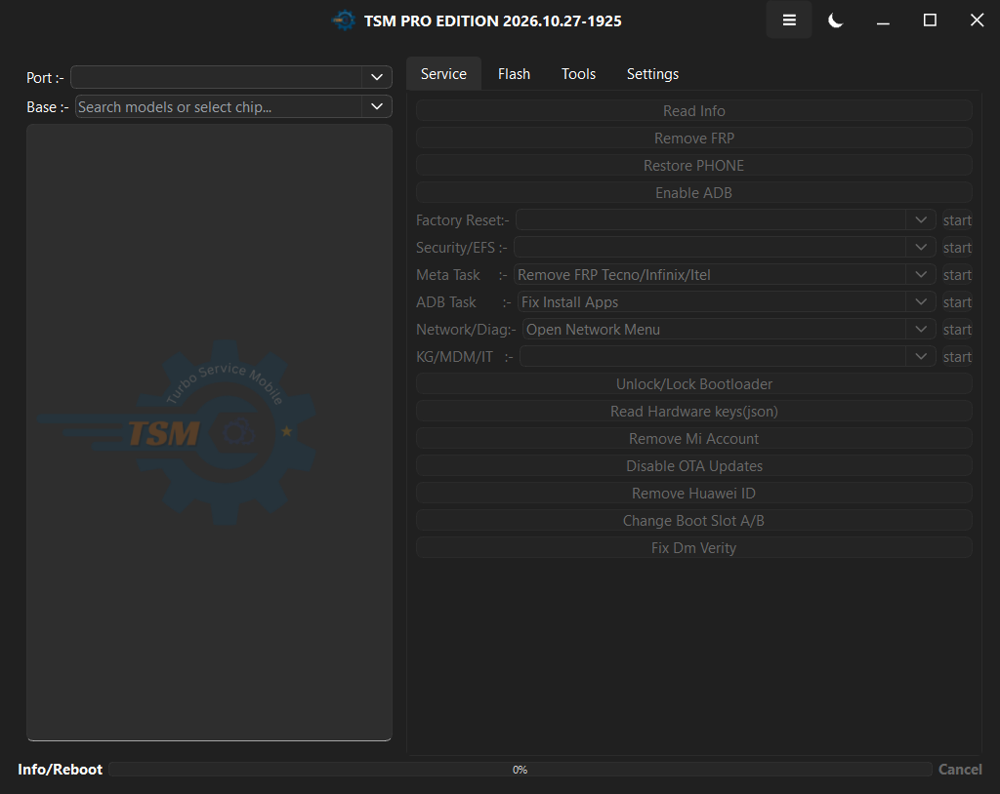

# TSM PRO Edition: security review

I reviewed TSM PRO Edition 2026.10.27-1925 in November 2026. The work covered
the login flow, the Themida protection, the model catalogue request that follows login, and
the chipset service layer. This folder is the handover: one report, the binaries I worked
from, and the scripts I used.

AES key and the test account are in this file.

## The build

| | |
|---|---|
| Version | 2026.10.27-1925 |
| Format | PE32, Qt 5.14.2, MinGW |
| Protector | Themida / WinLicense |
| Packed file | 33,443,840 bytes, SHA-256 `8ac50ca83c1fdb901aaaf5f77d460e6f0709c0556b044143c62b8a0ef9d17c78` |
| Unpacked module | 164,999,168 bytes, SHA-256 `c0f06405a4416e7be4f1fb76394ed033ac09027a7440e39134f4b5467c8752ae` |
| Image base | `0x400000` |
| Manifest | `requestedExecutionLevel level="requireAdministrator"` |
| Backend | `https://www.tsm-tool.com/` |

It is a 32-bit Qt application, so it runs under WOW64 on a normal x64 Windows box. The
manifest asks for administrator. For the UI and network tests I set
`__COMPAT_LAYER=RunAsInvoker` so it would start without a UAC prompt. Device operations may
still need an elevated process; that is a separate question from the login work.

The packed executable was never modified. Every patch described here is applied to the
process after it starts. The hash above is the original one.

## What I found

Four issues, ordered by how much they matter.

1. **The login can be forged.** The request and response are AES-256-CBC with a key compiled
   into every copy of the client. There is no server challenge, no signature, and no
   certificate pinning. The client also decides whether the login succeeded: it sets an
   internal flag, then clears it unless the response contains `"Annual": true`. A local relay
   is enough to open the main window without a valid account.

2. **Themida's tamper check can be removed at runtime.** The protection reacts to modified
   memory with a fixed exit code (`0xDEADC0DE`) and a message box. Both paths can be hooked
   from outside the process. This does not break the disk file, but it means runtime patching
   is not a real boundary.

3. **The model catalogue can be cached and replayed.** The catalogue itself is server-side
   and the server checks the account, which is the right call. But the client keeps the
   decrypted blob and loads it without a signature or an account binding. One capture with a
   valid account is enough to reuse it offline.

4. **The chipset layer is readable.** It is ordinary C++ with Qt metadata, not obfuscated
   beyond the packer. The eight vendor protocols and their command sequences can be recovered
   with a decompiler. The code is legitimate, but it is also the part that removes FRP,
   unlocks bootloaders, and wipes partitions.

If you fix only one thing, fix the first. The rest make the product easier to copy or misuse;
the first one removes the licence gate entirely.

## Login

### What goes over the wire

The client sends a GET with a body:

```http
GET /L9435eKcw HTTP/1.1
Host: www.tsm-tool.com
Content-Type: text/plain
Content-Length: 1376

<hex-encoded ciphertext>
```

The captured body is 688 bytes of ciphertext, which becomes 1,376 hex characters. It is not a
form post and there is no `Authorization` header. The account credentials are inside the
encrypted JSON.

The plaintext is a single-line system profile:

```json
{
  "Brand": "To Be Filled By O.E.M.",
  "CpuArch": "x86_64",
  "CurrentBuild": "43328433",
  "CurrentVersion": "2026.10.27-1925",
  "Email": "<account email>",
  "GPU": "<any>",
  "Language": "",
  "Memory": "23.92GB (6.24GB available)",
  "Model": "To Be Filled By O.E.M.",
  "OS": "<any>",
  "Password": "<account password>",
  "Processor": "<any>",
  "ProductName": "Windows 10",
  "RegisteredOwner": "<registered owner>",
  "ScreenSize": "1080\\1920",
  "Serial": "<machine serial>",
  "SpaceRoot": "953.01GB (440.03GB available)",
  "TSM_EDITION": "2026.10.27-1925",
  "kernelType": "winnt",
  "machineHost": "<hostname>"
}
```

The password goes over the wire inside that blob. There is no nonce, timestamp, or per-session
salt, so the same request can be replayed.

### The crypto

| | |
|---|---|
| Algorithm | AES-256-CBC |
| Key (ASCII, 32 bytes) | `64e04cbc4ff5d9f957322a808c087f2f` |
| IV (ASCII, 16 bytes) | `51985c8f03b2fbd5` |
| Suffix | `X*DEX$YE#2024` |
| Request padding | ISO/IEC 7816-4 (`0x80`, then zeroes) |
| Response padding | PKCS#7 |

The key looks like hex but is used as ASCII: thirty-two characters, thirty-two key bytes.
Same for the IV. If you paste them into a tool that expects raw hex you will get the wrong
ciphertext.

The suffix is appended before encryption and removed after decryption. It is a magic string,
not a MAC.

A minimal decryptor:

```python
from Crypto.Cipher import AES

KEY    = b"64e04cbc4ff5d9f957322a808c087f2f"
IV     = b"51985c8f03b2fbd5"
SUFFIX = b"X*DEX$YE#2024"

def decrypt(blob: bytes) -> bytes:
    pt = AES.new(KEY, AES.MODE_CBC, IV).decrypt(blob)
    pad = pt[-1]
    if 1 <= pad <= 16 and pt[-pad:] == bytes([pad]) * pad:
        pt = pt[:-pad]
    return pt
```

For a request, the padding is ISO 7816-4 instead of PKCS#7: strip the suffix, walk back over
the trailing zeroes, then drop the final `0x80`.

### The success condition

My first fake response was `{"Login": "Login Success"}`. The UI printed the string and then
did nothing. No main window.

The login handler keeps its result at `[this+0x48]` (handler at `0x135C684`). The plan/expiry
panel runs after the response is parsed, and if `Annual` is false or missing it writes zero
back to that flag. The main window is only created if the flag is still set. So the response
has to contain:

```json
{"Login": "Login Success", "Annual": true}
```

`Update` must be absent or `null`; an empty string takes a different branch. The payload I
ended up using is:

```json
{
  "Login": "Login Success",
  "Annual": true,
  "Balance": false,
  "Token": "0123456789abcdef0123456789abcdef",
  "Country": "US",
  "Version": "2026.10.27-1925",
  "Days": 365,
  "CurrentPlan": "PRO",
  "CurrentPlanName": "PRO",
  "ActivatedDate": "2026-11-05",
  "msg": ""
}
```

The token is not checked locally. It is sent back in the catalogue request, where the server
rejects it if it is not real.

This is the interesting part of the finding. The server's answer is not what decides the
login. The client does, and the client can be fed anything that parses.

### The relay

`PoC/auth_addon.py` is a mitmproxy addon. It replaces every response from `tsm-tool.com` with
the encrypted success payload:

```python
def encrypt_response(obj):
    body = json.dumps(obj, separators=(",", ":")).encode() + SUFFIX
    pad = 16 - (len(body) % 16)
    body += bytes([pad]) * pad
    return AES.new(KEY, AES.MODE_CBC, IV).encrypt(body).hex().encode()
```

`PoC/launch_tsm.pyw` saves the current WinINET proxy, points it at `127.0.0.1:8080`, starts
mitmdump, launches the client, and restores the proxy when the client exits.
`PoC/login_worker.ps1` uses UI Automation to fill the two edits and click Login. The observed
status was:

```text
worker start
hwnd=1378406
edits=2 login=True
login clicked
main=True after 8
worker exit
```

That is the whole bypass. No debugger, no driver, no kernel component.

### The second request

Shortly after login the client calls:

```http
GET /XM7R2K5P8W?Data=<hex>
```

`Data` decrypts to:

```json
{"Email":"<email>","Password":"<password>","Serial":"<serial>","Token":"<token>","lite":"0"}
```

The real server returns `401` and an encrypted body:

```json
{"Info": "failed auth"}
```

The full catalogue is server-side. The executable only carries a small fallback list:

```text
Redmi 13C, Poco C65, Redmi 14C, Redmi A3 Pro, Poco C75, Redmi Pad SE 8.7,
Redmi 15c, Redmi A3, Poco C61, Poco C50, Redmi 13, Redmi 13x,
Redmi Note 13 5G, Redmi Note 13R Pro, POCO X6 Neo 5G
```

With a forged login the catalogue request fails and the list stays empty. That is why the
login bypass does not hand over the paid catalogue by itself. It does open the application and
the operations that do not need the catalogue.

## Anti-tamper

The first time I patched the models call in memory, the client showed:

```text
File corrupted! This program has been manipulated and maybe
it's infected by a Virus or cracked. This file won't work anymore.
```

Dismissing it killed the process. A run with the dialog suppressed exited with `0xDEADC0DE`.

That constant appears once in the unpacked module, which makes it a good anchor:

```asm
0x7B45AA0   push 0xDEADC0DE
0x7B45AA5   push -1
0x7B45AA7   push eax
0x7B45AA8   call 0x7F0BEF4        ; ExitProcess
0x7B45AAD   ret
```

Writing `31 C0 C3` (`xor eax, eax; ret`) over the first three bytes makes the stub return
without exiting. That removes one path but not the dialog.

The imports are resolved dynamically, so IAT hooks do not see them. What worked was an inline
hook on the `user32.dll` exports. I read the `MessageBoxW`/`MessageBoxA` RVAs from the on-disk
`SysWOW64\user32.dll`, allocated a stub in the target, and patched the export entry with a
five-byte `E9 rel32` jump:

```asm
B8 01 00 00 00   mov eax, 1      ; IDOK
C2 10 00         ret 16          ; stdcall, four arguments
```

Every message box in the process now returns `IDOK`. That includes the application's own
dialogs, which is fine for a test harness and not fine for a production tool.

`ExitProcess` got the same treatment, with a check so normal exits still work:

```asm
8B 44 24 04              mov eax, [esp+4]
3D DE C0 AD DE           cmp eax, 0xDEADC0DE
75 05                    jne original
31 C0                    xor eax, eax
C2 04 00                 ret 4
<5 saved prologue bytes>
E9 <rel32>
```

The models plugin was a separate problem. Its entry is `0x1358550`, and the HTTP helper call
inside it is at `0x13587CC` (`call 0xA0A004`). Patching the whole function to return
immediately crashes the client because the same function also initialises plugin state.
Patching only the call site:

```asm
31 C0 90 90 90
```

lets the plugin take its normal error path. In some builds the request still fires, the relay
answers with an encrypted error, and the window stays usable.

Two launch details matter. `SW_SHOWMINNOACTIVE` leaves this build with no window, so the
launcher uses `SW_SHOWNORMAL` (`--show-normal`). And `__COMPAT_LAYER=RunAsInvoker` avoids the
UAC prompt from the manifest.

None of this modifies the file. The vendor hash stays the same before and after the test.

## Chipset layer

`Worker::run` at `0x136FFCC` dispatches on a task type. The jump table is at `0x299B48C`, the
task factory at `0xA2ECD4`, and `Worker::setTask` at `0x1371C80`.

| Type | Chipset |
|---:|---|
| 2 | MediaTek |
| 3 | Qualcomm |
| 4 | Spreadtrum / Unisoc |
| 5 | Kirin / HiSilicon |
| 6 | ADB |
| 7 | Fastboot |
| 8 | Exynos |
| 9 | Samsung |

Worker fields:

| Offset | Object |
|---|---|
| `+0x140` | Qualcomm task |
| `+0x144` | MTKCommIO task |
| `+0x14C` | SPDCommIO task |
| `+0x150` | HisiCommIO task |
| `+0x154` | Fastboot task |
| `+0x158` | ADB task |
| `+0x15C` | Exynos task |
| `+0x160` | Samsung task |
| `+0x170` | context |

Entry points:

| Chipset | Address | Method |
|---|---|---|
| Qualcomm | `0x123F904` | `qcom::Qualcomm::qPerformTask` |
| MediaTek | `0x14C0100` | `MTKCommIO::mPerformTask` |
| Spreadtrum | `0x12DC4B8` | `qsprd::SPDCommIO::uPerformTask` |
| Kirin | `0xA0D640` | `HisiCommIO::hPerformTask` |
| Fastboot | `0xD5E70C` | `fb::FbDriver::fPerformTask` |
| ADB | `0xAABEE8` | `adb::AdbShellSession::aPerformTask` |
| Exynos | `0x1188F30` | `EXYWinCommIO::ePerformTask` |
| Samsung | `0xD37824` | `SAMWinCommIO::sPerformTask` |

The class names come from the Qt metaobjects and the method name strings; they are not
guesses. The field offsets come from the decompiled access patterns.

Qualcomm's object keeps the task type at `+0x10`, a read-forbidden flag at `+0x167`, context
at `+0x170`, a connected flag at `+0x189`, and an extra string at `+0x1F4`. MTK uses `+0x18`
for the task type and `+0x1F4` for the string. SPD uses `+0xA8` and `+0x5A8`. Kirin, Fastboot,
ADB, Exynos and Samsung each have their own small structure; the offsets are in the cleaned
files.

What each implementation does is exactly what the UI suggests:

- Qualcomm: EFS reset, FRP unlock, factory reset, format-data, build-data, `boot-recovery`,
  and partition work on `modemst1`, `modemst2`, `fsg`, `fsc`, `misc`, `userdata`, `cache`.
  Methods include `qIdentDevice`, `QcomReadData`, `qPatchData`, `qErasePart`, `eraseDisk`,
  `qWritePart`, `SetupFhCFG`, `XiaomiBypassAuth`, `remove_huawei_id`, `remove_mi_account`.
- MediaTek: PMT parsing, read/write, OTP, AES-CMAC, RPMB/FDE key handling, `UnlockRelockBootloader`,
  `MTK_V6_MOTO_UPDFlash`, `TRN_Remove_SecPlugin`.
- SPD/Unisoc: `uConnectDevice`, `qFDLSendCMD`, `qSprdConnectDA`, `readDiagInfo`, `writeNvDump`.
- Kirin: handshake and loader checks, task types 4, 8, 9 and `0x64`.
- Fastboot: FRP removal (`HuaweiKey`, `Xiaomi`, `Generic`), bootloader lock/unlock, slot detection.
- ADB: QR/test/enable modes, adb server start, temporary app install, FRP/Knox clear, reboot.
- Exynos/Samsung: ODIN and MTP flows, device info, FRP/ADB enable, factory reset, AT commands
  (`AT+SWATD`, `AT+REACTIVE`, `AT+RSTVERIF`, `AT+FACTORST`, `AT+DEVCONINFO`, `AT+SVCIFPGM`).

### Decompiling it

RetDec v5.0 on the full 165 MB image dies with `std::bad_alloc`. Feeding it selected ranges
works:

```bat
retdec-decompiler.exe --cleanup --timeout 3600 --no-memory-limit ^
  --select-decode-only ^
  --select-ranges 0xA00000-0xA12000,0xAA0000-0xAC0000,0xD30000-0xD70000,0x1140000-0x11A0000,0x1200000-0x1260000,0x12A0000-0x1300000,0x1480000-0x1510000,0xA2E000-0xA33000,0x136F000-0x1373000 ^
  -o TSM-chipsets.c unpacked-module.exe
```

The Windows release also needs `libcrypto-1_1-x64.dll` from OpenSSL 1.1.1w in `retdec\bin`.
It is not bundled, and without it the decompiler exits before doing any work. The run produced
14,730,414 bytes and 432,330 lines.

I then renamed the entry functions, put the lost `this` pointer back as `self`, named the Qt
helpers that could be matched by pattern, and added the field offsets as comments. The cleaned
per-chipset files are in `PoC/decompiled/`. They are still pseudocode: `sub_<address>` calls
are unresolved, `vN` are compiler temporaries, and the code will not compile without the
original types.

The full 14.7 MB corpus is not in this folder because it is mostly context. The cleaned
functions are the useful part. Ask me if you want the raw dump; I still have it.

## What is in the folder

```text
TSM-Security-Report/
├── README.md            this file
├── Binaries/
│   ├── TSM-PRO-Edition.packed.exe
│   └── unpacked-module.exe
└── PoC/
    ├── auth_addon.py
    ├── launch_tsm.pyw
    ├── login_worker.ps1
    ├── capture_models.py
    ├── stop_tsm.pyw
    ├── clean_retdec.py
    ├── extract_retdec_funcs.py
    ├── extract_worker.py
    ├── requirements.txt
    ├── certs/           research CA and private key
    ├── evidence/        captures, logs, screenshot
    ├── decompiled/      cleaned per-chipset pseudocode
    ├── logs/            raw test template (contains the test account)
    └── research/        exploratory scripts, kept for traceability
```

`Binaries/unpacked-module.exe` is the pe-sieve dump the address references point at. The packed
file is the original build.

### Evidence

`PoC/evidence/` has the pieces that back the claims:

- `request_ciphertext.bin`, the 688-byte login request body.
- `response_not_registered.hex`, the real server answer for an unregistered account. It is hex
  text, not raw bytes; decode it before decrypting.
- `requests.log` and `login_served.txt`, showing the relay answering `/L9435eKcw`.
- `login_status.txt`, ending with `main=True after 8`.
- `login_real.json`, the decrypted text of the real response.
- `ui_after.txt` and `launcher.log`.
- `main-window-after-login.png`, the window on the Service tab.
- `supported_models.html`, the public model page captured during the test.



The real response decrypts to:

```json
{"Login": "Your account is not registered"}
```

## Sensitive material

This folder contains things that should not be published.

The AES key and IV are in the protocol section above. They are the same in every copy of this
build. The research CA and its private key are in `PoC/certs/`; they were used to intercept
the client's HTTPS traffic on the test machine. The raw login template in `PoC/logs/` has the
test account and the machine identifiers:

```text
Email    : test@example.com
Password : Test12345!
Serial   : 2611AF44B1BED28030765EBDC5E4A9F1
Hostname : DESKTOP-U4V1NQ5
```

That account was disposable. If it still exists, disable it. If the password is reused
anywhere, change it.

The CA must be removed from any trust store it was installed into:

```powershell
certutil -user -delstore Root "mitmproxy"
```

Check both stores:

```powershell
Get-ChildItem Cert:\CurrentUser\Root   | Where-Object Subject -like "*mitmproxy*"
Get-ChildItem Cert:\LocalMachine\Root  | Where-Object Subject -like "*mitmproxy*"
```

Before sharing this outside the authorised group, remove `PoC/certs/`, `PoC/logs/`, the key
block above, and the binaries. The login details and the decompiled code are the parts that
would help someone copy the product.

## Reproducing it

You need Windows 10 or 11, Python 3.11 or newer, and the client binary.

```powershell
python -m pip install -r PoC\requirements.txt
certutil -user -addstore Root "PoC\certs\mitmproxy-ca-cert.cer"
python PoC\launch_tsm.pyw --compat-invoker --patch-themida --no-models --show-normal
```

The launcher looks for `..\Binaries\TSM-PRO-Edition.packed.exe` and `certs\` next to itself.
`TSM_EXE` and `TSM_MITM_CONF` override those paths.

Useful flags:

| Flag | What it does |
|---|---|
| `--compat-invoker` | Sets `RunAsInvoker`; avoids UAC |
| `--patch-themida` | Exit-stub patch plus the message-box and exit hooks |
| `--no-models` | Patches the catalogue call site |
| `--show-normal` | Uses `SW_SHOWNORMAL`; required on this build |
| `--no-auto` | Skips the UI Automation step |
| `--keep-proxy` | Leaves the proxy set until the client exits |
| `--proxy-grace N` | Seconds to keep the proxy after the login is served |
| `--hidden` | Runs on a private desktop, for tests that must not take focus |

Expected result: `PoC/logs/requests.log` shows the intercepted URL, `login_status.txt` ends
with `main=True`, and the main window opens on the Service tab.

If the launcher is interrupted, restore the proxy with:

```powershell
python PoC\stop_tsm.pyw
```

To capture a real catalogue with a test account:

```powershell
python PoC\capture_models.py --email <account> --password <password>
```

The script reads `PoC/logs/login_request_template.json`, which is already in this package. It
writes `PoC/models_blob.hex`, and the addon serves that blob for `/XM7R2K5P8W` on later runs.

## Fixing it

The order matters. The first two items remove the finding; the rest make the next review
shorter.

**Replace the static key and sign the response.** A symmetric key that ships in every copy is
not a secret. Use a per-session key from an ECDH exchange, or keep TLS with certificate
pinning and sign the payload with a server key the client verifies. A constant suffix is not a
MAC.

**Move the entitlement decision to the server.** Issue a short-lived token that contains the
plan and expiry, sign it, and have the client verify the signature and the expiry. The client
should not be able to mint a valid token by editing JSON. Add a nonce and a timestamp so
responses cannot be replayed.

**Pin the certificate.** The client currently trusts whatever root the machine trusts, which
is why the mitmproxy CA worked. Pin the API host.

**Bind the session to the account and the machine.** The server should tie the token to the
account, the hardware serial, and the login time, and invalidate it on password change.

**Sign and expire the catalogue.** Bind the cache to the account that fetched it. Do not
resend the account password in the catalogue request; the token is enough.

**Authorise destructive operations server-side.** FRP removal, bootloader unlock and factory
reset should need a short-lived operation token for the specific device and account, and
should be logged with the technician's identity. Right now the client decides.

**Treat anti-tamper as a speed bump.** It is bypassable, and that is normal on a machine the
user controls. Do not make product decisions that depend on it. If you keep it, vary the
failure paths and check the code that performs the check, not just the payload.

## Caveats

The decompiled code is machine output. It is useful for understanding the control flow, not
for rebuilding the product. The addresses are for this build and will move after a rebuild.
The UI Automation selectors depend on the current Qt widget tree. The catalogue is server-side
and was not obtained during this test, so the catalogue section is based on the protocol and
the server's `401`, not on the catalogue contents.

The scripts in `PoC/research/` are archival. They still contain absolute paths from the
original lab and are not meant to run unchanged.

The on-disk executable is untouched. Everything in this report that modifies behaviour does
so in memory, which is why the hash still matches the file the client supplied.
